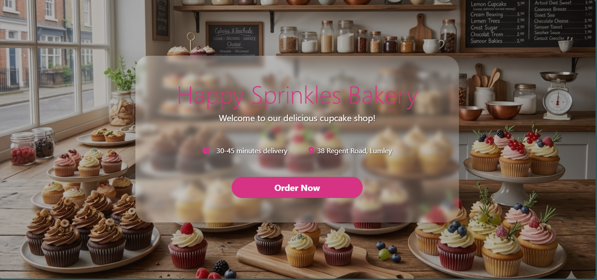
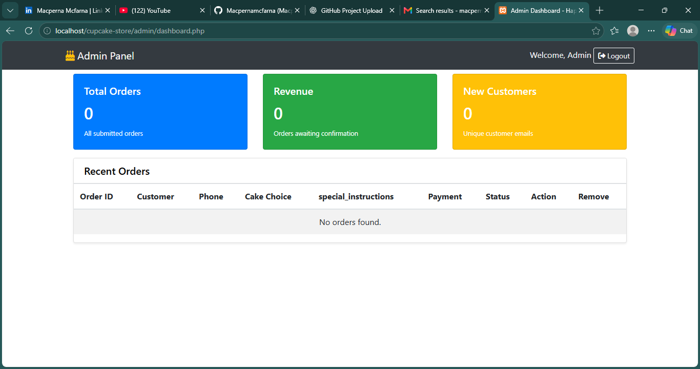

# Happy Sprinkles Bakery — Cupcake Store

A PHP and MySQL web application for managing cupcake orders. The project includes a customer-facing ordering page and an admin dashboard for viewing and managing orders.

## 🎬 Screenshots

### Homepage


### Behind the Scenes — Admin Dashboard


> Add your screenshots to the `screenshots/` folder using the filenames shown above.

## 🎥 Features

- Customer-facing bakery homepage
- Cupcake ordering form
- Customer details and special instructions
- Payment method selection
- Admin dashboard for viewing orders
- Order statistics and pending-order tracking
- Order deletion functionality
- Environment-based database configuration

## 🎞️ Technologies Used

- **Backend:** PHP
- **Database:** MySQL
- **Database connection:** MySQLi
- **Frontend:** HTML, CSS, JavaScript
- **Local development:** XAMPP
- **Version control:** Git and GitHub

## 🎭 Project Structure

```text
Cupcake-Store/
├── admin/
│   ├── dashboard.php
│   ├── login.php
│   └── register.php
├── backend/
│   ├── database.php
│   ├── delete.php
│   └── process.php
├── public/
│   ├── index.php
│   ├── order.php
│   ├── success.php
│   ├── script.js
│   ├── style.css
│   └── images/
├── screenshots/
│   ├── homepage.png
│   └── admin-dashboard.png
├── .env.example
├── .gitignore
└── README.md
```

## 🎬 Getting Started

Follow these steps to run the project locally.

### Prerequisites

Install the following:

- [XAMPP](https://www.apachefriends.org/)
- [Git](https://git-scm.com/)

### 1. Clone the Repository

```bash
git clone https://github.com/Macpernamcfarna/Cupcake-Store.git
```

### 2. Move the Project into XAMPP

Place the project folder inside your XAMPP `htdocs` directory.

Example:

```text
C:\xampp\htdocs\Cupcake-Store
```

### 3. Create the Database

1. Start Apache and MySQL from the XAMPP Control Panel.
2. Open [phpMyAdmin](http://localhost/phpmyadmin/).
3. Create a database named `cake-orders`.
4. Create the required orders table using the schema for this project.

**Note:** The database and required table must exist before submitting orders. A `database.sql` file would make setup easier by allowing developers to import the schema directly into phpMyAdmin.

### 4. Configure Environment Variables

Copy `.env.example` to `.env` in the project root.

Configure your local database credentials in `.env`:

```ini
DB_HOST=localhost
DB_USER=root
DB_PASS=""
DB_NAME=cake-orders
```

Adjust these values if your MySQL installation uses different credentials.

**Security note:** Keep `.env` private. It contains local configuration and should not be committed to GitHub. Commit `.env.example` instead, without real passwords or secrets.

### 5. Run the Application

Open the following URL in your browser:

```text
http://localhost/Cupcake-Store/public/
```

## 🔒 Security Notes

This project is intended for learning and portfolio development. It should not be deployed publicly without additional security work.

Before production deployment, implement and verify:

- Secure admin authentication and authorization
- Server-side validation of customer input
- CSRF protection for state-changing actions
- Protected order deletion
- Safe error handling and private server-side logging
- Secure database credentials and appropriate database permissions

## 🎞️ Future Improvements

- Complete the admin login and registration functionality
- Add secure session management
- Add order status updates
- Improve order validation and error handling
- Add a database schema and sample data file
- Correct and improve dashboard statistics
- Improve responsive design

## 🎬 Author

**Macperna Mcfarna**

- GitHub: [@Macpernamcfarna](https://github.com/Macpernamcfarna)
- Portfolio: [Visit my portfolio](https://macpernamcfarna.github.io/private-webpage/)

## 📽️ License

This project is intended for learning and portfolio development. Add a `LICENSE` file if you choose to distribute it under a specific open-source license.
